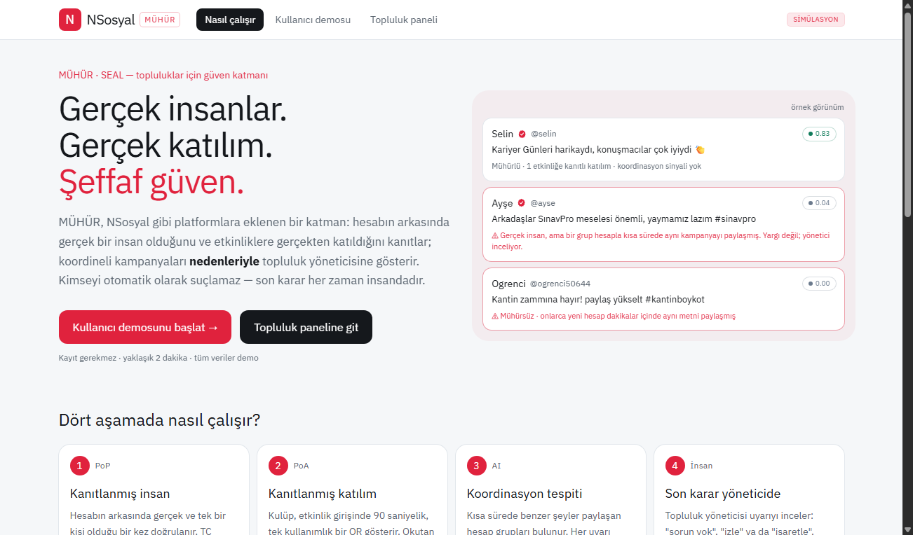
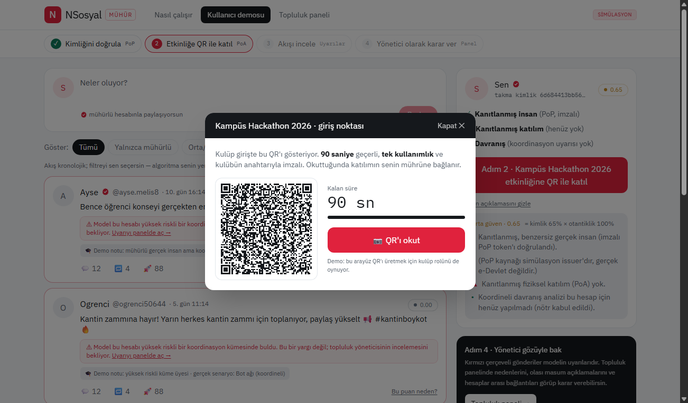
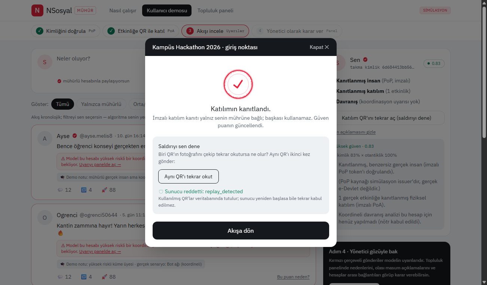
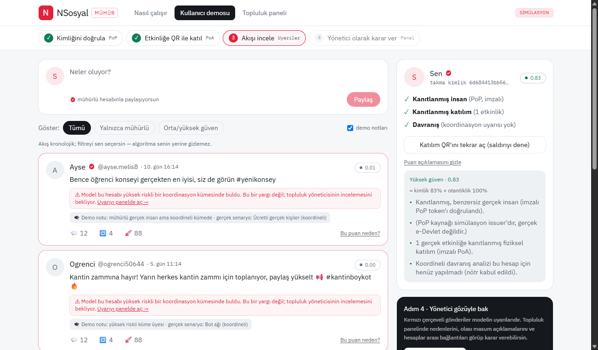
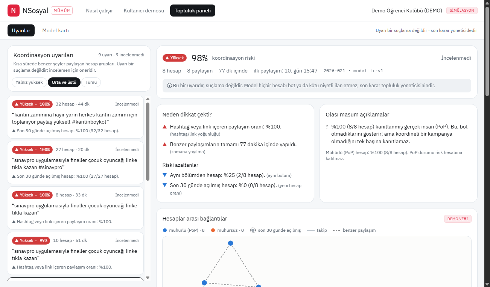
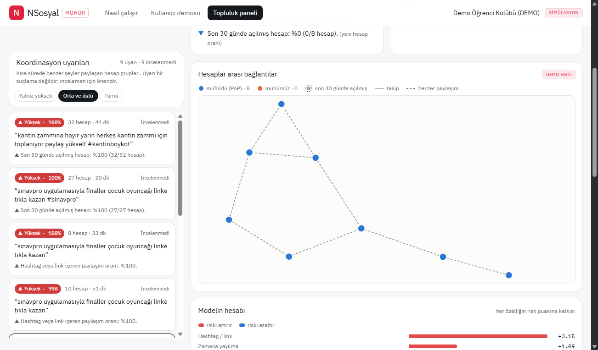
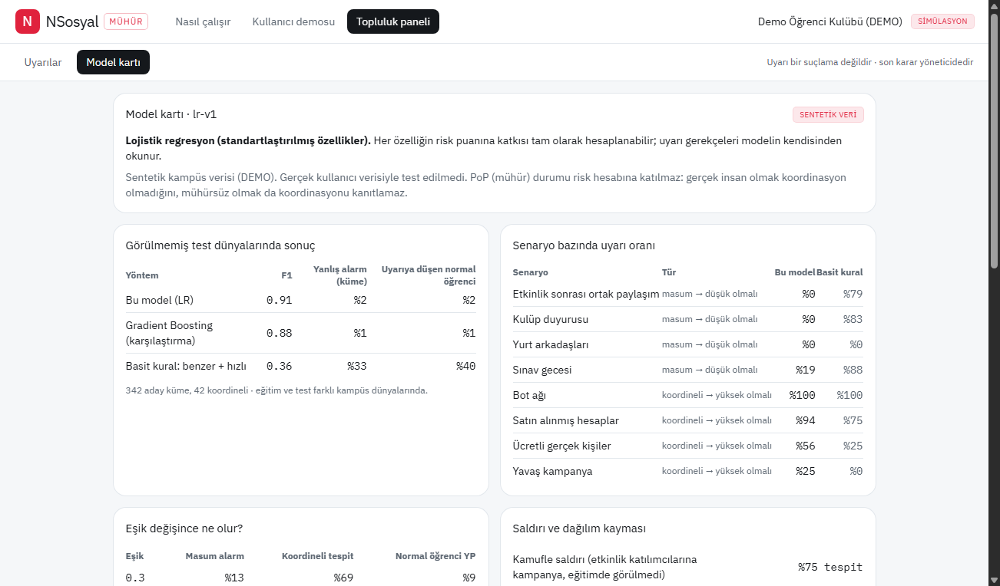

<div align="center">

# 🛡️ NSosyal MÜHÜR · SEAL

### Gerçek insanlar. Gerçek katılım. Şeffaf güven.

Topluluk platformları için güven katmanı: hesabın arkasında **gerçek bir insan** olduğunu ve
etkinliklere **gerçekten katıldığını** kanıtlar; koordineli kampanyaları **nedenleriyle** topluluk
yöneticisine gösterir. Kimseyi otomatik olarak suçlamaz — **son karar her zaman insandadır.**

**TEKNOFEST 2026 — NSosyal İnovasyon** · **NFTE World Series of Innovation**

[](https://omertugrulbayram.github.io/muhur/)
[](#-test-ve-saldırı-koşumu)
[](#-test-ve-saldırı-koşumu)


<br>



> ⚠️ **Dürüstlük notu:** Kimlik doğrulama bir **simülasyondur** (gerçek e-Devlet entegrasyonu yoktur).
> Tüm kullanıcı verisi **sentetiktir**. Aşağıdaki rakamların hepsi bu depodaki kod çalıştırılarak üretilmiştir.

</div>

---

## 📖 İçindekiler

- [Tek tıkla çalıştır](#️-tek-tıkla-çalıştır)
- [Problem ve çözüm](#-problem-ve-çözüm)
- [Dört aşama](#-dört-aşama)
- [Ekranlar](#️-ekranlar)
- [Sonuçlar](#-sonuçlar)
- [Güvenlik](#-güvenlik)
- [Ne gerçek, ne demo?](#-ne-gerçek-ne-demo)
- [Test ve saldırı koşumu](#-test-ve-saldırı-koşumu)
- [Geliştirici notları](#-geliştirici-notları)
- [Proje yapısı](#-proje-yapısı)
- [Yol haritası](#️-yol-haritası)

---

## ▶️ Tek tıkla çalıştır

**Windows:** `BASLAT.bat` dosyasına çift tıkla. İlk seferde Python ortamını kurar ve arayüzü derler,
sonra tarayıcıda **http://127.0.0.1:8000** açılır. Site ve API aynı adresten sunulur.

Gereken: **Python 3.11+** ve **Node.js 18+**.

| Sayfa | Adres | Ne var? |
|---|---|---|
| Açılış | `/#/` | Dört aşama, rakamlar, ne gerçek / ne demo |
| Kullanıcı demosu | `/#/demo` | ① e-Devlet (simülasyon) ile mühür → ② QR ile etkinliğe katılım + replay saldırısını deneme → ③ akış ve güven gerekçeleri |
| Topluluk paneli | `/#/panel` | Uyarılar, nedenler, olası masum açıklamalar, ağ grafiği, insan incelemesi, model kartı |

Kayıt gerekmez; tüm akış yaklaşık iki dakika sürer.

---

## 🎯 Problem ve çözüm

Sosyal platformların ortak açığı: bir hesabın arkasında **gerçekten benzersiz bir insan** olup olmadığı
doğrulanamıyor. Bu açık; bot ağlarının, satın alınmış hesapların ve **para karşılığı kampanyaya katılan
gerçek kişilerin** gündemi yapay biçimde şekillendirmesine yol açıyor.

Ama "şüpheli görünen" her şey kötü niyetli değil: aynı etkinlikten dönen onlarca öğrenci benzer şeyler yazar,
kulüp üyeleri duyuruyu birebir kopyalar, sınav gecesi herkes aynı dersten bahseder. **Basit bir kural bunları
da suçlar.** MÜHÜR'ün farkı: kanıtlanmış kimlik ve katılımı, açıklanabilir bir modelle ve insan kararıyla
birleştirmesi.

## 🧩 Dört aşama

| | Aşama | Ne yapar? | Nasıl? |
|:---:|---|---|---|
| 1 | **Kanıtlanmış insan** (PoP) | Hesabın arkasında gerçek ve tek bir kişi olduğunu bir kez doğrular | TC saklanmaz; tek yönlü HMAC takma kimlik + "15 yaş üstü" bilgisi; Ed25519 imzalı token |
| 2 | **Kanıtlanmış katılım** (PoA) | Etkinliğe fiziksel katılımı kişiye bağlı, imzalı bir kanıta çevirir | Yalnız organizatörün üretebildiği 90 sn'lik, tek kullanımlık QR |
| 3 | **Koordinasyon tespiti** (AI) | Kısa sürede benzer şeyler paylaşan hesap gruplarını bulur | Küme düzeyinde açıklanabilir model; her uyarıda neden + olası masum açıklama |
| 4 | **Son karar insanda** | Yönetici uyarıyı inceler: *sorun yok / izle / işaretle* | Kalıcı inceleme kaydı; güven puanını istemci değiştiremez |

---

## 🖼️ Ekranlar

### Kullanıcı demosu — QR ile etkinliğe katılım ve saldırıyı kendin dene

<table>
<tr>
<td width="50%"><br>
<sub><b>② Etkinliğe katılım:</b> kulübün imzaladığı gerçek QR, 90 saniyelik geri sayım. Okutunca güven puanı <code>0.65 → 0.83</code>.</sub></td>
<td width="50%"><br>
<sub><b>"Saldırıyı sen dene":</b> aynı QR'ı ikinci kez okutunca sunucu <code>replay_detected</code> ile reddeder — sunucu yeniden başlasa bile.</sub></td>
</tr>
</table>

### Akış — uyarılar ve "Bu puan neden?"


<sub>Model uyarıları kırmızı çerçeveyle; en üstteki hesap <b>mühürlü gerçek bir insan</b> ama koordineli bir kampanyanın içinde. Sağda kullanıcının kendi mührü ve puanının açıklaması.</sub>

### Topluluk paneli — nedenler, masum açıklamalar, insan kararı


<sub>8 hesabın 8'i mühürlü gerçek insan, ama 77 dakikada aynı "öğrenci konseyi" kampanyasını paylaşmışlar. Panel nedenlerini gösterir ve "gerçek insan olmaları koordinasyon olmadığını kanıtlamaz" diye not düşer. Karar yöneticinindir.</sub>

<table>
<tr>
<td width="50%"><br>
<sub><b>Hesaplar arası bağlantılar:</b> mühürlü/mühürsüz, yeni hesap, takip ve benzer paylaşım.</sub></td>
<td width="50%"><br>
<sub><b>Model kartı:</b> basit kurala karşı sonuçlar, senaryo oranları, eşik ve saldırı tabloları, bilinen sınırlar.</sub></td>
</tr>
</table>

---

## 📊 Sonuçlar

Sentetik kampüste **4 masum** (etkinlik sonrası paylaşım, kulüp duyurusu, yurt arkadaşları, sınav gecesi) ve
**4 koordineli** senaryo (bot ağı, satın alınmış hesap, ücretli gerçek kişi, yavaş kampanya).
12 dünyada eğitim, **hiç görülmemiş 8 dünyada** test.

| | MÜHÜR modeli | Basit kural *(benzer metin + kısa süre)* |
|---|:---:|:---:|
| F1 | **0.91** | 0.36 |
| Uyarıya düşen normal öğrenci | **%2,4** | %40 |
| Kulüp duyurusunda yanlış alarm | **%0** | %83 |
| Etkinlik paylaşımında yanlış alarm | **%0** | %79 |
| Ücretli gerçek kişileri yakalama | **%56** | %25 |
| Kamufle saldırı *(eğitimde görülmedi)* | **%75** | — |

**Bilinçli tasarım kararları**
- **Hesap değil küme:** model "bu hesap bot" demez; "bu grup kısa sürede benzer şeyler paylaşmış, nedenleri şunlar" der.
- **Lojistik regresyon:** her uyarının gerekçesi modelin katkılarından (katsayı × değer) okunur, sonradan yazılmış metin değildir.
- **PoP durumu modelde yok:** gerçek insan olmak koordinasyon olmadığını, mühürsüz olmak da koordinasyonu kanıtlamaz.
- **Bağlam yalnız içerikle tutarlıysa sayılır:** "ortak etkinliğe katılmışlar" bilgisi, paylaşımlar o etkinlikten bahsediyorsa riski düşürür. (İlk sürümde bu kural istismar edilebiliyordu: kamufle saldırı %0 → düzeltme sonrası %75.)

**Zayıf noktalar da açık:** farklı cümlelerle ve hashtag'siz yazılan kampanyaların ~1/3'ü aday kümeye girmiyor;
yavaş kampanyada tespit %25; sınav gecesinde %19 yanlış alarm.
Tam değerlendirme: [`docs/model_degerlendirme.md`](docs/model_degerlendirme.md)

---

## 🔐 Güvenlik

İlke: **istemciye güvenilmez.** Güven kararını etkileyen her girdi ya sunucunun imzaladığı bir token'dır ya da sunucunun kendi kaydıdır.

| | Önce (denetim, 23 Kasım) | Şimdi |
|---|---|---|
| Elle yazılmış JSON "kanıtla" güven puanı | ❌ **0.9997** veriyordu | ✅ 422 reddedilir |
| İstemcinin kendi bot olasılığını göndermesi | ❌ kabul ediliyordu | ✅ 422 reddedilir |
| Etkinliğe gitmeden QR üretmek | ❌ herkes üretebiliyordu | ✅ yalnız etkinlik sahibi organizatör |
| Kullanılmış QR listesi | ⚠️ bellekte, yeniden başlatınca sıfır | ✅ SQLite, kalıcı |
| İmza | ⚠️ HS256 (doğrulayan da imzalayabilir) | ✅ Ed25519; açık anahtarlar `/.well-known/muhur-keys` |
| Arayüzdeki risk değerleri | ❌ koda elle yazılmış sabitler | ✅ tamamı modelden |

Ayrıca: takma kimlik için ayrı anahtar, kişi başına etkinlik başına tek katılım, sıkı CORS, istek sınırı,
fail-closed ayarlar (demo/üretimde anahtar eksikse servis başlamaz).
Ayrıntı: [`docs/threat_model.md`](docs/threat_model.md)

---

## ✅ Ne gerçek, ne demo?

| ✅ Gerçekten çalışıyor | ◌ Simülasyon / demo | △ Henüz yok |
|---|---|---|
| Ed25519 imzalı kimlik ve katılım kanıtları | e-Devlet girişi | Gerçek kullanıcı testi |
| TC'nin hiçbir yere yazılmaması (DB dahil testli) | Hesaplar ve paylaşımlar (sentetik kampüs) | Organizatör hesapları / rolleri |
| Organizatör yetkili, tek kullanımlık QR | Model sonuçları (yalnız sentetik veride) | Anlam düzeyinde metin benzerliği |
| Kandırılamayan sunucu tarafı güven puanı | Demoda arayüz, QR üretmek için kulüp rolünü de oynar | İnternette yayın |
| Arayüze bağlı açıklanabilir model | | "İlişkilendirilemez" kimlik (şu an: takma adlı) |
| Yönetici paneli + kalıcı insan incelemesi | | KVKK değerlendirmesi |

Başvuru metinleri için ayrıntılı tablo: [`docs/durum_tablosu.md`](docs/durum_tablosu.md)

---

## 🧪 Test ve saldırı koşumu

```powershell
cd backend
.venv\Scripts\python -m pytest -q                      # 74 passed
cd ..
backend\.venv\Scripts\python attack_harness\replay_attack.py   # 15/15 saldırı engellendi
```

Testler: sahte imza, `alg=none`, algoritma karıştırma, yanlış issuer/audience/tür, süresi dolmuş token,
replay (sunucu yeniden başladıktan sonra dahil), çift katılım, başkasının kanıtını kullanma, yetkisiz QR,
istemcinin risk göndermesi, CORS, istek sınırı, TC'nin hiçbir çıktıda ve DB dosyasında olmaması,
açıklamaların modelle tutarlılığı, kamufle saldırı.

---

## 🛠️ Geliştirici notları

<details>
<summary><b>Ayrı ayrı çalıştırma (geliştirme modu)</b></summary>

```powershell
# backend
cd backend
python -m venv .venv
.venv\Scripts\python -m pip install -r requirements.txt
.venv\Scripts\python -m uvicorn app.main:app --reload       # http://127.0.0.1:8000/docs

# arayüz (ayrı terminal)
cd frontend
npm install
npm run dev                                                  # http://localhost:5173
```

Vite başka bir porta geçerse backend'i `MUHUR_CORS_ORIGINS=http://localhost:<port>` ile başlat.
Demo kulübün organizatör anahtarı (yalnız geliştirme): `demo-kulup-anahtari`.
</details>

<details>
<summary><b>Modeli yeniden eğitme ve sağlamlık deneyleri</b></summary>

```powershell
cd backend
.venv\Scripts\python -m app.ml.train_coordination --json app\ml\models\coordination_eval.json
.venv\Scripts\python -m app.ml.robustness --json app\ml\models\robustness.json
```
</details>

<details>
<summary><b>API uçları</b></summary>

| Yöntem | Uç | Yetki | Açıklama |
|---|---|---|---|
| `GET` | `/health` | — | Servis durumu |
| `GET` | `/.well-known/muhur-keys` | — | Açık anahtarlar (JWKS) |
| `POST` | `/pop/verify` | — | Kimlik doğrulama (simülasyon) → Ed25519 imzalı personhood token |
| `GET/POST` | `/organizer/events` | organizatör | Etkinlikleri listele / oluştur |
| `POST` | `/poa/challenge` | organizatör | Kendi açık etkinliği için 90 sn'lik tek kullanımlık QR |
| `POST` | `/poa/checkin` | — | QR + personhood token → imzalı katılım kanıtı |
| `POST` | `/trust/score` | — | Yalnız imzalı token'lar; risk değeri sunucudan |
| `GET` | `/organizer/alerts` | organizatör | Koordinasyon uyarıları |
| `GET` | `/organizer/alerts/{id}` | organizatör | Gerekçeler, masum açıklamalar, ağ grafiği, inceleme geçmişi |
| `POST` | `/organizer/alerts/{id}/review` | organizatör | İnsan kararı: `sorun_yok` / `izle` / `isaretle` |
| `GET` | `/organizer/model` | organizatör | Model kartı |
| `GET` | `/demo/personas` | — | **Simülasyon:** akış demosu için sentetik kampüs hesapları |

Organizatör yetkisi `X-Organizer-Key` başlığıyla verilir; anahtarlar DB'de SHA-256 özeti olarak saklanır.
</details>

---

## 📁 Proje yapısı

```
muhur/
├── BASLAT.bat            # tek tıkla kur, derle, çalıştır
├── backend/app/
│   ├── pop/              # kanıtlanmış insan — mock issuer, takma kimlik, Ed25519
│   ├── poa/              # kanıtlanmış katılım — QR challenge, check-in, katılım kanıtı
│   ├── security/         # anahtarlar, token imzalama/doğrulama, istek sınırı
│   ├── db/               # SQLite kayıtları
│   ├── trust/            # güven puanı (saf formül + token doğrulayan servis)
│   ├── ml/               # sentetik kampüs, koordinasyon modeli, eğitim, sağlamlık
│   ├── analysis/         # modeli ürüne bağlayan katman (uyarılar, panel)
│   └── main.py           # FastAPI + derlenmiş sitenin sunulması
├── frontend/src/         # Landing · Demo · Panel (React + Tailwind)
├── attack_harness/       # 15 saldırılık koşum
└── docs/                 # değerlendirme, tehdit modeli, durum tablosu, görseller
```

---

## 🗺️ Yol haritası

- [x] Kanıtlanmış insan — takma kimlik, Ed25519 imzalı token
- [x] Kanıtlanmış katılım — organizatör yetkili QR, kalıcı replay engeli, etkinlik başına tek katılım
- [x] Sunucu tarafı, kandırılamayan güven puanı
- [x] Açıklanabilir koordinasyon modeli, arayüze bağlı
- [x] Topluluk yöneticisi paneli + insan incelemesi
- [x] Zor masum senaryolar, ablasyon, kamufle saldırı, dağılım kayması testleri
- [x] Rehberli demo sitesi, tek tıkla çalıştırma
- [ ] İnternette yayın + 1–2 dakikalık demo videosu
- [ ] Gerçek kullanıcı pilotu (onam, veri minimizasyonu, itiraz hakkı, etik onay)
- [ ] Anlam düzeyinde metin benzerliği (Türkçe cümle gömmeleri), GNN karşılaştırması
- [ ] Gerçek dijital kimlik altyapısına entegrasyon

---

<div align="center">
<sub>NSosyal MÜHÜR (SEAL) · TEKNOFEST 2026 NSosyal İnovasyon · NFTE World Series of Innovation<br>
📄 Geliştirme raporu: <a href="https://omertugrulbayram.github.io/muhur/">omertugrulbayram.github.io/muhur</a></sub>
</div>
