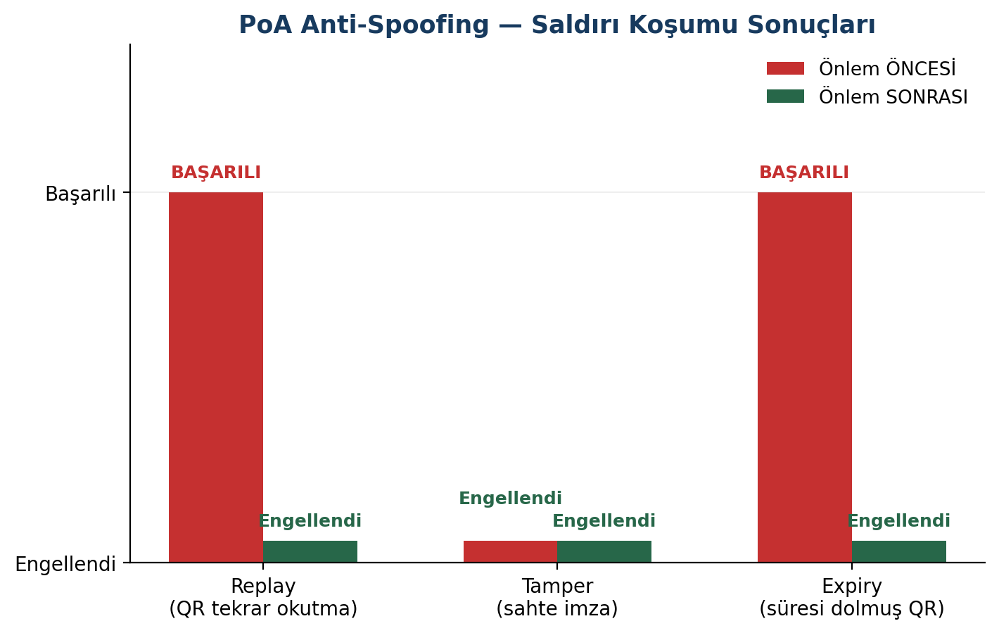

<div align="center">

# 🛡️ NSosyal MÜHÜR

### Kanıtlanmış Gerçek İnsan · Kanıtlanmış Gerçek Katılım
### Güven, Otantiklik ve Şeffaf Keşif Katmanı

**TEKNOFEST 2026 — NSosyal İnovasyon Yarışması** · İnovasyon Dikeyi: *Sosyal Yapay Zekâ*

[](#-proje-durumu)
[](#-teknoloji-yığını)
[](#-teknoloji-yığını)
[](#-test)
[](#-lisans)

<br>

> ⚠️ **Dürüstlük notu:** Kimlik doğrulama akışı bir **SİMÜLASYONDUR** (mock issuer).
> Gerçek e-Devlet entegrasyonu yoktur. Sistem, standart-uyumlu, bağımsız çalışan
> bir **referans uygulamadır.**

</div>

---

## 📖 İçindekiler

- [Problem](#-problem)
- [Çözüm — MÜHÜR](#-çözüm--mühür)
- [Sistem Mimarisi](#-sistem-mimarisi)
- [Öne Çıkan Sonuçlar](#-öne-çıkan-sonuçlar)
- [Teknoloji Yığını](#-teknoloji-yığını)
- [Kurulum ve Çalıştırma](#-kurulum-ve-çalıştırma-windows)
- [API Uçları](#-api-uçları)
- [Test](#-test)
- [Saldırı Koşumu (Anti-Spoofing Kanıtı)](#-saldırı-koşumu-anti-spoofing-kanıtı)
- [Proje Yapısı](#-proje-yapısı)
- [Yol Haritası](#-yol-haritası)
- [Ekip](#-ekip)

---

## 🎯 Problem

Sosyal medya platformlarının ortak yapısal açığı: **bir hesabın arkasında gerçekten
benzersiz bir insan olup olmadığının doğrulanamaması** — kısaca *"kimliksizlik açığı"*.

Bu açık; botların gündemi yapay biçimde şekillendirmesine, koordineli kampanyalarla
bir fikrin veya kişinin sabote edilmesine ve platformun *"gerçeklik"* vaadinin
söylemde kalmasına yol açar. NSosyal, kendisini **"gerçek insanların, manipülasyondan
uzak, temiz alanı"** olarak konumlandırdığından, bu açık NSosyal için doğrudan
**varoluşsal bir tehdittir.**

## 💡 Çözüm — MÜHÜR

**NSosyal MÜHÜR**, bu vaadi bir slogandan çıkarıp **teknik olarak icra eden** bir
güven katmanıdır. İki temel doğrulamaya dayanır:

| | |
|---|---|
| 🧬 **PoP** — *Proof of Personhood* | Hesabın arkasında kanıtlanmış, benzersiz, gerçek bir insan olduğunu doğrular. TC kimlik **saklanmaz** — yalnızca tek yönlü HMAC ile üretilmiş bir takma kimlik (*"benzersizlik nişanı"*) tutulur. |
| 📍 **PoA** — *Proof of Attendance* | Gerçek bir etkinliğe (TEKNOFEST vb.) fiziksel katılımı, sahtelenmeye dirençli kriptografik bir nişana çevirir. |

Bunun üzerine kurulu **Sybil/CIB tespit modeli**, sahte hesap ağlarını ve koordineli
manipülasyonu yapay zekâ ile yakalar; **şeffaf keşif katmanı** ise her içerik için
*"Neden bunu görüyorum?"* açıklaması sunar — gizli algoritma yok, kara kutu yok.

## 🏗️ Sistem Mimarisi

<div align="center">

<br>
<sub><b>Zincir:</b> kanıtlanmış insan → kanıtlanmış katılım → manipülasyona dirençli güven → şeffaf keşif</sub>
</div>

Sistem, birbirinden bağımsız çalışabilen servislerden oluşur — bu sayede NSosyal'in
kapalı geliştirici API'sine bağımlı olmadan, **bağımsız ve entegrasyona hazır bir
referans uygulama** olarak çalışır.

## 📊 Öne Çıkan Sonuçlar

Aşağıdaki sonuçlar **uydurma değildir** — bu repodaki kod çalıştırılarak üretilmiştir.

<table>
<tr>
<td width="50%" align="center">
<br>
<sub><b>Ağ sinyalinin katkısı:</b> ağ öznitelikleri çıkarıldığında<br>Recall <code>1.000 → 0.556</code> düşer.</sub>
</td>
<td width="50%" align="center">
<br>
<sub><b>Anti-spoofing:</b> önlemler açıkken<br>tüm saldırılar (<code>replay</code>, <code>tamper</code>, <code>expiry</code>) engellenir.</sub>
</td>
</tr>
</table>

| Model (Sybil/CIB — Gradient Boosting baseline) | Precision | Recall | F1 | AUC |
|---|:---:|:---:|:---:|:---:|
| **Tüm öznitelikler** (bireysel + ağ) | 0.978 | **1.000** | **0.989** | **0.998** |
| Yalnızca bireysel (ablasyon) | 0.962 | 0.556 | 0.704 | 0.866 |

> 5-kat çapraz doğrulama F1: **0.973** · Sentetik benchmark, 1000 hesap, %15 koordineli bot
> (gizlenen + yalnız-kurt botlar dahil), %30 görülmeyen test kümesi.

## 🧰 Teknoloji Yığını

<div align="center">


</div>

| Katman | Teknoloji | Durum |
|---|---|---|
| Backend | FastAPI + Pydantic (bilinmeyen alanlar reddedilir) | ✅ çalışıyor |
| Veritabanı | SQLite (kullanılmış QR'lar, katılımlar, organizatörler, risk kayıtları) | ✅ çalışıyor |
| Kimlik (PoP) | PyJWT · **Ed25519** imza · HMAC-SHA256 takma kimlik | ✅ çalışıyor (issuer simülasyon) |
| Katılım (PoA) | Ed25519 imzalı tek kullanımlık QR + imzalı katılım kanıtı | ✅ çalışıyor |
| Yapay Zekâ | scikit-learn: açıklanabilir lojistik regresyon (küme düzeyinde koordinasyon), TF-IDF | ✅ arayüze bağlı · 🟡 yalnız sentetik veride ölçüldü |
| Ön Yüz | React (Vite) + Tailwind | ✅ çalışıyor |
| Test | pytest (74 test) + saldırı koşumu (15 saldırı) | ✅ |
| Planlanan | GraphSAGE (GNN), Türkçe metin benzerliği | ❌ henüz yok |

## ▶️ Tek tıkla çalıştır (Windows)

`BASLAT.bat` dosyasına çift tıkla. İlk seferde Python ortamını kurar ve arayüzü
derler, sonra tarayıcıda **http://127.0.0.1:8000** açılır. Site ve API aynı
adresten sunulur.

| Sayfa | Adres | Ne var? |
|---|---|---|
| Açılış | `/#/` | Dört aşama, rakamlar, ne gerçek / ne demo |
| Kullanıcı demosu | `/#/demo` | ① e-Devlet (simülasyon) ile mühür → ② QR ile etkinliğe katılım + replay saldırısını deneme → ③ akış ve güven gerekçeleri |
| Topluluk paneli | `/#/panel` | Uyarılar, nedenler, masum açıklamalar, ağ grafiği, insan incelemesi, model kartı |

Gereken: Python 3.11+ ve Node.js 18+.

## 🚀 Kurulum ve Çalıştırma (Windows)

```powershell
cd backend
python -m venv .venv
.venv\Scripts\activate
pip install -r requirements.txt
uvicorn app.main:app --reload
```

Sonra tarayıcıda aç:

- 📘 API dokümantasyonu → `http://127.0.0.1:8000/docs`
- 💓 Sağlık kontrolü → `http://127.0.0.1:8000/health`

## 🖥️ Arayüz

```powershell
cd frontend
npm install
npm run dev
```

- NSosyal akışı → `http://localhost:5173/` (e-Devlet simülasyonu ile giriş)
- **Topluluk yöneticisi paneli** → `http://localhost:5173/#/panel` (demo kulüp anahtarı hazır gelir)

## 🧠 Koordinasyon modeli

```powershell
cd backend
.venv\Scripts\python -m app.ml.train_coordination
```

12 sentetik kampüs dünyasında eğitir, görülmemiş 8 dünyada test eder:

| | LR (ürün) | Basit kural |
|---|---|---|
| F1 | **0.91** | 0.36 |
| Uyarıya düşen normal öğrenci | **%2.4** | %40 |
| Kamufle saldırı tespiti (eğitimde görülmedi) | **%75** | — |
| Kulüp duyurusunda yanlış alarm | **%0** | %83 |

Ayrıntı ve zayıf noktalar: [`docs/model_degerlendirme.md`](docs/model_degerlendirme.md)

## 🔌 API Uçları (v0.4)

| Yöntem | Uç | Yetki | Açıklama |
|---|---|---|---|
| `GET` | `/health` | — | Servis durumu |
| `GET` | `/.well-known/muhur-keys` | — | Açık anahtarlar (JWKS): herkes token'ları bağımsız doğrulayabilir |
| `POST` | `/pop/verify` | — | Kimlik doğrulama (simülasyon) → Ed25519 imzalı personhood token |
| `GET/POST` | `/organizer/events` | organizatör | Etkinlikleri listele / oluştur |
| `POST` | `/poa/challenge` | organizatör | Kendi açık etkinliği için 90 sn'lik tek kullanımlık QR |
| `POST` | `/poa/checkin` | — | QR + personhood token → imzalı katılım kanıtı (kişi başına etkinlik başına 1) |
| `POST` | `/trust/score` | — | Yalnız imzalı token'larla çalışır; risk değeri sunucudan gelir |
| `GET` | `/organizer/alerts` | organizatör | Koordinasyon uyarıları (risk sırasıyla, `min_level` filtresi) |
| `GET` | `/organizer/alerts/{id}` | organizatör | Gerekçeler, masum açıklamalar, ağ grafiği, paylaşımlar, inceleme geçmişi |
| `POST` | `/organizer/alerts/{id}/review` | organizatör | İnsan kararı: `sorun_yok` / `izle` / `isaretle` + not |
| `GET` | `/organizer/model` | organizatör | Model kartı: katsayılar, değerlendirme, sınırlar |
| `GET` | `/demo/personas` | — | **SİMÜLASYON:** akış demosu için sentetik kampüs hesapları |
| `POST` | `/demo/risk` | organizatör | **SİMÜLASYON:** elle risk değeri (yalnız demo modunda; arayüz kullanmıyor) |

Organizatör yetkisi `X-Organizer-Key` başlığıyla verilir. Anahtarlar veritabanında
SHA-256 özeti olarak saklanır. Geliştirme ortamında demo kulübün anahtarı
`demo-kulup-anahtari`'dır.

## 🧪 Test

```powershell
cd backend
.venv\Scripts\python -m pytest -q
```

```
62 passed
```

Testler; sahte imza, `alg=none`, algoritma karıştırma, yanlış issuer/audience/tür,
süresi dolmuş token, replay (sunucu yeniden başladıktan sonra dahil), çift
katılım, başkasının kanıtını kullanma, yetkisiz QR üretme, istemcinin risk
değeri göndermesi, CORS ve istek sınırını kapsar. TC kimlik numarasının hiçbir
çıktıda ve veritabanı dosyasında bulunmadığı da test edilir.

## ⚔️ Saldırı Koşumu

```powershell
backend\.venv\Scripts\python attack_harness\replay_attack.py
eplay_attack.py
```

Gerçek HTTP API'ye karşı 15 saldırı dener. Sonuç (2026-11-24): **15/15 engellendi.**
Ayrıntı: [`docs/threat_model.md`](docs/threat_model.md) · Gerçek/demo ayrımı:
[`docs/durum_tablosu.md`](docs/durum_tablosu.md)

## 📁 Proje Yapısı

```
muhur/
├── backend/
│   └── app/
│       ├── pop/          # Proof-of-Personhood — mock issuer, takma kimlik, Ed25519
│       ├── security/     # anahtarlar, token imzalama/doğrulama, istek sınırı
│       ├── db/           # SQLite kayıtları
│       ├── poa/          # Proof-of-Attendance — QR + anti-spoofing
│       ├── ml/           # sentetik kampüs, koordinasyon modeli, eğitim/değerlendirme
│       ├── analysis/     # modeli ürüne bağlayan katman (uyarılar, panel görünümleri)
│       ├── trust/        # Güven puanı (saf formül + token doğrulayan servis)
│       └── main.py       # FastAPI giriş noktası
├── attack_harness/       # Saldırı simülasyon scriptleri
├── docs/                 # Mimari, tehdit modeli, benchmark, görseller
└── frontend/             # React arayüzü
```

## 🗺️ Yol Haritası

- [x] PoP — mock issuer, takma kimlik, Ed25519 imzalı token
- [x] PoA — organizatör yetkili, tek kullanımlık QR; kalıcı replay listesi; etkinlik başına tek katılım
- [x] Sybil/CIB baseline model (Gradient Boosting) + benchmark (sentetik)
- [x] Güven puanı — sunucu tarafında, yalnız imzalı kanıtlarla
- [x] Koordinasyon modeli API'ye ve arayüze bağlı, açıklanabilir uyarılar
- [x] Topluluk yöneticisi paneli (şüpheli kümeler, ağ grafiği, insan incelemesi, model kartı)
- [x] Zor masum senaryolarla test, yanlış pozitif ölçümü ([`docs/model_degerlendirme.md`](docs/model_degerlendirme.md))
- [ ] İnternette yayın + demo video
- [ ] Gerçek kullanıcı testi (onam ve gizlilik planıyla)
- [ ] GraphSAGE (GNN) ile karşılaştırma
- [ ] Gerçek e-Devlet / dijital kimlik altyapısına entegrasyon

## 👥 Ekip

Siber güvenlik, yapay zekâ ve ürün geliştirme disiplinlerinden oluşan çok
disiplinli bir takım. *(Detaylı rol dağılımı teknik raporda yer almaktadır.)*

---

<div align="center">
<sub>NSosyal MÜHÜR — TEKNOFEST 2026 NSosyal İnovasyon Yarışması için geliştirilmiştir.</sub>
</div>
