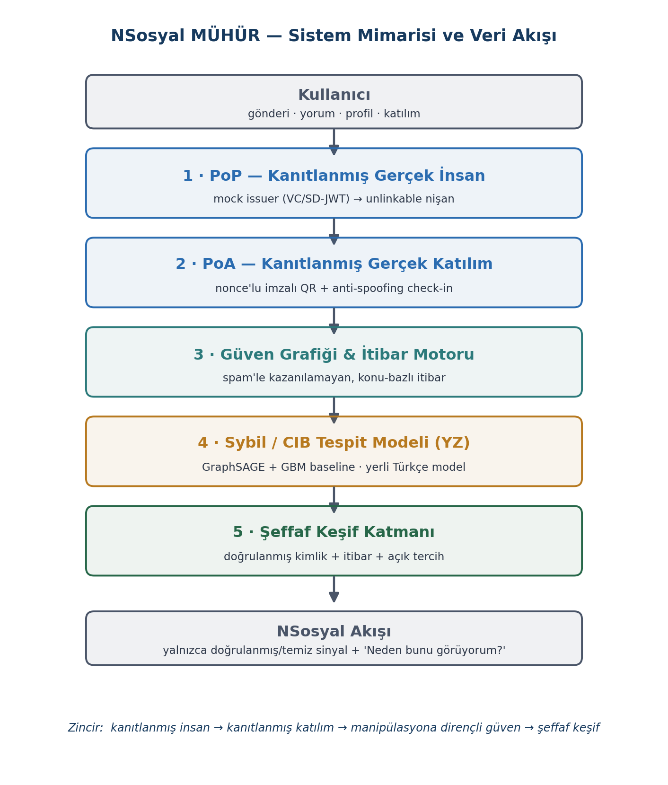
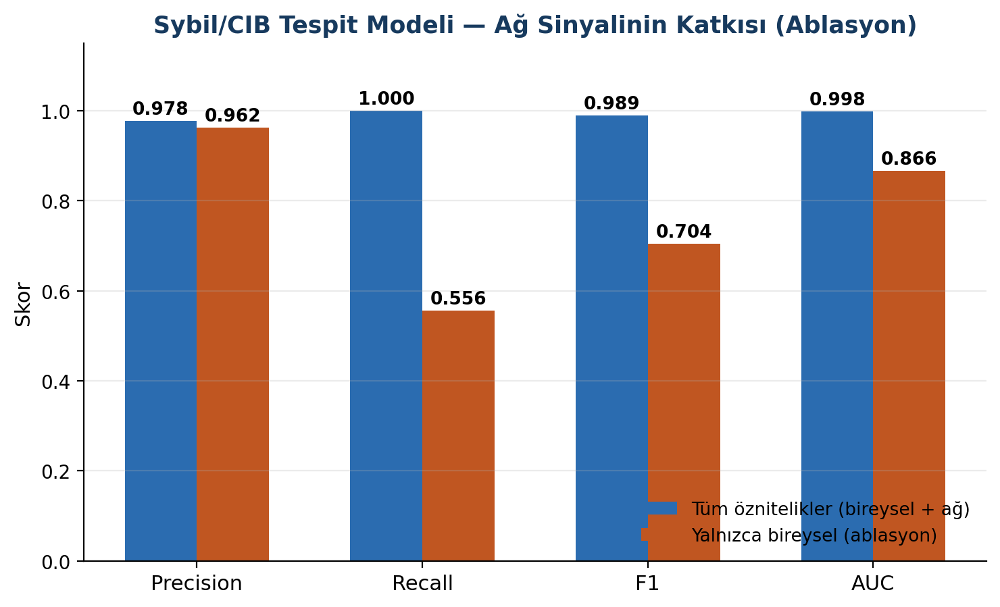

<div align="center">

# 🛡️ NSosyal MÜHÜR

### Kanıtlanmış Gerçek İnsan · Kanıtlanmış Gerçek Katılım
### Güven, Otantiklik ve Şeffaf Keşif Katmanı

**TEKNOFEST 2026 — NSosyal İnovasyon Yarışması** · İnovasyon Dikeyi: *Sosyal Yapay Zekâ*

[](#-proje-durumu)
[](#-teknoloji-yığını)
[](#-teknoloji-yığını)
[](#-test)
[](#-lisans)

<br>

> ⚠️ **Dürüstlük notu:** Kimlik doğrulama akışı bir **SİMÜLASYONDUR** (mock issuer).
> Gerçek e-Devlet entegrasyonu yoktur. Sistem, standart-uyumlu, bağımsız çalışan
> bir **referans uygulamadır.**

</div>

---

## 📖 İçindekiler

- [Problem](#-problem)
- [Çözüm — MÜHÜR](#-çözüm--mühür)
- [Sistem Mimarisi](#-sistem-mimarisi)
- [Öne Çıkan Sonuçlar](#-öne-çıkan-sonuçlar)
- [Teknoloji Yığını](#-teknoloji-yığını)
- [Kurulum ve Çalıştırma](#-kurulum-ve-çalıştırma-windows)
- [API Uçları](#-api-uçları)
- [Test](#-test)
- [Saldırı Koşumu (Anti-Spoofing Kanıtı)](#-saldırı-koşumu-anti-spoofing-kanıtı)
- [Proje Yapısı](#-proje-yapısı)
- [Yol Haritası](#-yol-haritası)
- [Ekip](#-ekip)

---

## 🎯 Problem

Sosyal medya platformlarının ortak yapısal açığı: **bir hesabın arkasında gerçekten
benzersiz bir insan olup olmadığının doğrulanamaması** — kısaca *"kimliksizlik açığı"*.

Bu açık; botların gündemi yapay biçimde şekillendirmesine, koordineli kampanyalarla
bir fikrin veya kişinin sabote edilmesine ve platformun *"gerçeklik"* vaadinin
söylemde kalmasına yol açar. NSosyal, kendisini **"gerçek insanların, manipülasyondan
uzak, temiz alanı"** olarak konumlandırdığından, bu açık NSosyal için doğrudan
**varoluşsal bir tehdittir.**

## 💡 Çözüm — MÜHÜR

**NSosyal MÜHÜR**, bu vaadi bir slogandan çıkarıp **teknik olarak icra eden** bir
güven katmanıdır. İki temel doğrulamaya dayanır:

| | |
|---|---|
| 🧬 **PoP** — *Proof of Personhood* | Hesabın arkasında kanıtlanmış, benzersiz, gerçek bir insan olduğunu doğrular. TC kimlik **saklanmaz** — yalnızca geri döndürülemez, ilişkilendirilemez bir *"benzersizlik nişanı"* tutulur. |
| 📍 **PoA** — *Proof of Attendance* | Gerçek bir etkinliğe (TEKNOFEST vb.) fiziksel katılımı, sahtelenmeye dirençli kriptografik bir nişana çevirir. |

Bunun üzerine kurulu **Sybil/CIB tespit modeli**, sahte hesap ağlarını ve koordineli
manipülasyonu yapay zekâ ile yakalar; **şeffaf keşif katmanı** ise her içerik için
*"Neden bunu görüyorum?"* açıklaması sunar — gizli algoritma yok, kara kutu yok.

## 🏗️ Sistem Mimarisi

<div align="center">

<br>
<sub><b>Zincir:</b> kanıtlanmış insan → kanıtlanmış katılım → manipülasyona dirençli güven → şeffaf keşif</sub>
</div>

Sistem, birbirinden bağımsız çalışabilen servislerden oluşur — bu sayede NSosyal'in
kapalı geliştirici API'sine bağımlı olmadan, **bağımsız ve entegrasyona hazır bir
referans uygulama** olarak çalışır.

## 📊 Öne Çıkan Sonuçlar

Aşağıdaki sonuçlar **uydurma değildir** — bu repodaki kod çalıştırılarak üretilmiştir.

<table>
<tr>
<td width="50%" align="center">
<br>
<sub><b>Ağ sinyalinin katkısı:</b> ağ öznitelikleri çıkarıldığında<br>Recall <code>1.000 → 0.556</code> düşer.</sub>
</td>
<td width="50%" align="center">
<br>
<sub><b>Anti-spoofing:</b> önlemler açıkken<br>tüm saldırılar (<code>replay</code>, <code>tamper</code>, <code>expiry</code>) engellenir.</sub>
</td>
</tr>
</table>

| Model (Sybil/CIB — Gradient Boosting baseline) | Precision | Recall | F1 | AUC |
|---|:---:|:---:|:---:|:---:|
| **Tüm öznitelikler** (bireysel + ağ) | 0.978 | **1.000** | **0.989** | **0.998** |
| Yalnızca bireysel (ablasyon) | 0.962 | 0.556 | 0.704 | 0.866 |

> 5-kat çapraz doğrulama F1: **0.973** · Sentetik benchmark, 1000 hesap, %15 koordineli bot
> (gizlenen + yalnız-kurt botlar dahil), %30 görülmeyen test kümesi.

## 🧰 Teknoloji Yığını

<div align="center">


</div>

| Katman | Teknoloji | Amaç |
|---|---|---|
| Backend | FastAPI + Pydantic | API, şema doğrulama |
| Veritabanı | SQLite + SQLAlchemy | Prototip veri katmanı |
| Kimlik (PoP) | SD-JWT · PyJWT · HMAC-SHA256 | Unlinkable, mahremiyet-koruyan nişan |
| Katılım (PoA) | qrcode · imzalı nonce (JWT) | Sahtelenmeye dirençli check-in |
| Yapay Zekâ | scikit-learn/XGBoost · PyTorch Geometric (GraphSAGE) | Sybil/CIB tespiti |
| Türkçe NLP | HuggingFace Transformers (yerli model) | Spam/koordineli metin sınıflandırma |
| Ön Yüz | React (Vite) + Tailwind | Kullanıcı arayüzü |
| Test | pytest | Anti-spoofing ve mahremiyet garantileri |

## 🚀 Kurulum ve Çalıştırma (Windows)

```powershell
cd backend
python -m venv .venv
.venv\Scripts\activate
pip install -r requirements.txt
uvicorn app.main:app --reload
```

Sonra tarayıcıda aç:

- 📘 API dokümantasyonu → `http://127.0.0.1:8000/docs`
- 💓 Sağlık kontrolü → `http://127.0.0.1:8000/health`

## 🔌 API Uçları

| Yöntem | Uç | Açıklama |
|---|---|---|
| `GET` | `/health` | Servisin ayakta olduğunu doğrular |
| `POST` | `/pop/verify` | Kimlik doğrulama (simülasyon) → unlinkable nişan döner |
| `POST` | `/poa/qr` | Etkinlik için kısa ömürlü, imzalı check-in QR'ı üretir |
| `POST` | `/poa/checkin` | QR'ı doğrular; geçerliyse katılım nişanı verir |

## 🧪 Test

```powershell
cd backend
pytest
```

```
tests\test_poa.py ....                                       [ 50%]
tests\test_pop.py ....                                        [100%]
================== 8 passed ==================
```

Testler; **replay, tamper, expiry** saldırılarının reddedildiğini ve PoP'un
kimlik bilgisini **asla saklamadığını** doğrular.

## ⚔️ Saldırı Koşumu (Anti-Spoofing Kanıtı)

```powershell
python -m attack_harness.replay_attack
```

```
  Saldırı                         Önlem ÖNCESİ    Önlem SONRASI
  ------------------------------------------------------------
  Replay (QR tekrar okutma)       BAŞARILI        engellendi
  Tamper (sahte imza)             engellendi      engellendi
  Expiry (süresi dolmuş QR)       BAŞARILI        engellendi
```

## 📁 Proje Yapısı

```
muhur/
├── backend/
│   └── app/
│       ├── pop/          # Proof-of-Personhood — mock issuer, unlinkable nişan
│       ├── poa/          # Proof-of-Attendance — QR + anti-spoofing
│       ├── ml/           # Sybil/CIB tespit modeli + sentetik veri
│       ├── trust/        # Güven grafiği + itibar motoru
│       ├── discovery/    # Şeffaf keşif katmanı
│       └── main.py       # FastAPI giriş noktası
├── attack_harness/       # Saldırı simülasyon scriptleri
├── docs/                 # Mimari, tehdit modeli, benchmark, görseller
└── frontend/             # React arayüzü
```

## 🗺️ Yol Haritası

- [x] PoP — mock issuer, unlinkable kimlik doğrulama
- [x] PoA — anti-spoofing check-in (replay/tamper/expiry engelleri)
- [x] Sybil/CIB baseline model (Gradient Boosting) + benchmark
- [ ] GraphSAGE (GNN) ile karşılaştırma
- [ ] Güven grafiği + itibar motoru
- [ ] Şeffaf keşif katmanı ("Neden bunu görüyorum?")
- [ ] Gerçek millî e-Devlet / dijital rozet altyapısına canlı entegrasyon

## 👥 Ekip

Siber güvenlik, yapay zekâ ve ürün geliştirme disiplinlerinden oluşan çok
disiplinli bir takım. *(Detaylı rol dağılımı teknik raporda yer almaktadır.)*

---

<div align="center">
<sub>NSosyal MÜHÜR — TEKNOFEST 2026 NSosyal İnovasyon Yarışması için geliştirilmiştir.</sub>
</div>
